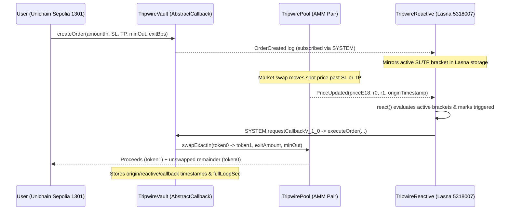

# Tripwire

**Sub-second Reactive Omni stop-loss and take-profit order automation for Unichain Sepolia.**

Built for the **Reactive Omni Buildathon — Every Second Counts** track using the official **Reactive Omni API** (`@reactive-lib-omni`: `SYSTEM = 0x8888888888888888888888888888888888888888`, `AbstractReactive`, `AbstractCallback`, `onlySystem`, `SYSTEM.requestCallbackV_1_0`).

---

## Why Omni (~1s) Matters Here

On volatile AMM pairs, a 7-second legacy reactive block time or a polling off-chain keeper means a stop-loss lands blocks after a cascade has already drained the pool. **Tripwire** keeps active stop-loss and take-profit brackets directly in Reactive Lasna state (`~1s` CometBFT finality, zero off-chain keepers) and emits a `requestCallbackV_1_0` unwind back to Unichain Sepolia the moment `TripwirePool` emits `PriceUpdated`.

A live testnet stop-loss (order #1, 2026-11-23) unwound in **2 seconds** end-to-end, with on-chain `fullLoopSec = 2` recorded by `TripwireVault`.

## Architecture



## Contracts

| Contract | Chain | Role |
| --- | --- | --- |
| `src/TripwireReactive.sol` | Reactive Lasna (`5318007`) | Inherits `AbstractReactive`. Subscribes to `OrderCreated`, `OrderCancelled`, and `PriceUpdated` via `SYSTEM.subscribe`. Evaluates brackets in `react()` (`onlySystem`) and dispatches `SYSTEM.requestCallbackV_1_0`. |
| `src/TripwireVault.sol` | Unichain Sepolia (`1301`) | Inherits `AbstractCallback`. Holds deposited `token0`, supports full or partial exits (`exitBps` 1..10000), enforces `onlyServiceProvider` + `onlyCallbackSender(reactive_)` + on-chain spot-price re-check + `minOut` slippage guard, and records full-loop latency on-chain. |
| `src/TripwirePool.sol` | Unichain Sepolia (`1301`) | Self-contained Uniswap-v2-style constant-product AMM pair (0.30% fee) emitting `Sync` and timestamped `PriceUpdated`. |
| `src/MockERC20.sol` | Unichain Sepolia (`1301`) | Minimal testnet ERC-20 (`tWETH`, `tUSDC`) for deterministic liquidity. |

## Live Testnet Deployment (2026-11-23, America/New_York)

Throwaway testnet deployer: `0x9196de8A181ae69FCB404C909CF63DBA528620e2`.

| Contract | Chain | Address | Explorer |
| --- | --- | --- | --- |
| `TripwireReactive` | Reactive Lasna (`5318007`) | [`0x5389083b1FbCE68ee6adD211D0E21b74F016EB71`](https://lasna.reactscan.net/address/0x5389083b1FbCE68ee6adD211D0E21b74F016EB71) | Deploy tx [`0xd2c2c830…9d1820`](https://lasna.reactscan.net/tx/0xd2c2c83063a8751b4980d2614ae44db3cd67a5e37e49c2c8d48b9148899d1820) · Configure tx [`0x6cebd444…cac2dd`](https://lasna.reactscan.net/tx/0x6cebd4449c6942415a25fd75e6d01b81fd2ac45191bd863bdfc9417a6dcac2dd) |
| `tWETH` | Unichain Sepolia (`1301`) | [`0x5389083b1FbCE68ee6adD211D0E21b74F016EB71`](https://sepolia.uniscan.xyz/address/0x5389083b1FbCE68ee6adD211D0E21b74F016EB71) | Deploy tx [`0x6978e609…ca4e25`](https://sepolia.uniscan.xyz/tx/0x6978e6093c16c09b5333d9c8a513c9643f2747feedcc404a23871178d2ca4e25) |
| `tUSDC` | Unichain Sepolia (`1301`) | [`0x27825D851BC38a216c907a35184da9187dce75a3`](https://sepolia.uniscan.xyz/address/0x27825D851BC38a216c907a35184da9187dce75a3) | Deploy tx [`0x3f15922e…751f31`](https://sepolia.uniscan.xyz/tx/0x3f15922eb77eecfc25a4829c29b43c50fc27ad1af70fdc7fd3df428ce5751f31) |
| `TripwirePool` | Unichain Sepolia (`1301`) | [`0x046646850A577bC15E20c9E22a75a38A241Ff0b9`](https://sepolia.uniscan.xyz/address/0x046646850A577bC15E20c9E22a75a38A241Ff0b9) | Deploy tx [`0xfc0df261…60273b`](https://sepolia.uniscan.xyz/tx/0xfc0df261a556e0dbc0878d757f625b0ce0db7446e6b15803a1582d087c60273b) |
| `TripwireVault` | Unichain Sepolia (`1301`) | [`0x04C8A3761BBe60C6DA7D013D038D29E91256bcD3`](https://sepolia.uniscan.xyz/address/0x04C8A3761BBe60C6DA7D013D038D29E91256bcD3) | Deploy tx [`0xb6081e64…e6466d`](https://sepolia.uniscan.xyz/tx/0xb6081e6466d46da08bf813e6fb895782f0cda9403a4d51e122b15fd51de6466d) |

Official callback proxy on Unichain Sepolia: [`0x775c9B990ADe401060B78D0e98684eEf8d2466C1`](https://sepolia.uniscan.xyz/address/0x775c9B990ADe401060B78D0e98684eEf8d2466C1). Lasna system contract: `0x8888888888888888888888888888888888888888`. The vault was funded with `0.02 ETH` and the reactive contract with `0.2 lREACT` so callbacks execute; both showed `debt = 0` after the live loop.

## Live End-to-End Stop-Loss (order #1)

Created a 2 tWETH stop-loss / take-profit bracket (`SL = 1,800`, `TP = 2,400`, `minOut = 3,000`, `exitBps = 10000`) at a 2,000 tUSDC/tWETH spot, then dumped 10 tWETH into the pool. Spot fell to `~1,653` (below SL). `TripwireReactive` fired and the vault unwound the full 2 tWETH for `3,238.07` tUSDC. On-chain `fullLoopSec = 2`, `averageFullLoopSec() = 2`.

| Stage | Chain | Tx Hash | Block Timestamp | Delta |
| --- | --- | --- | --- | --- |
| Origin Swap (`PriceUpdated`) | Unichain Sepolia (`1301`) | [`0x14e8de305d6c4a50e4d4f0b096d64d299e6ac2f1306f3a58c2516aea06420557`](https://sepolia.uniscan.xyz/tx/0x14e8de305d6c4a50e4d4f0b096d64d299e6ac2f1306f3a58c2516aea06420557) | 2026-11-23 19:26:10 UTC / 2026-11-23 02:26:10 PM ET (`1795461970`) | 0s |
| Reactive Evaluation (`react` / `TripwireFired`) | Reactive Lasna (`5318007`) | [`0x2f9ece0247b96d663d00e69cd0cff3ec4fbf0a5303973c15732871fd9bc4e938`](https://lasna.reactscan.net/tx/0x2f9ece0247b96d663d00e69cd0cff3ec4fbf0a5303973c15732871fd9bc4e938) | 2026-11-23 19:26:09 UTC / 2026-11-23 02:26:09 PM ET (`1795461969`) | -1s (chain clock skew) |
| Destination Unwind (`executeOrder`) | Unichain Sepolia (`1301`) | [`0xaa018e8db1b3eef7058c16bb956a8a11d21430b6f485707ac330846585e51557`](https://sepolia.uniscan.xyz/tx/0xaa018e8db1b3eef7058c16bb956a8a11d21430b6f485707ac330846585e51557) | 2026-11-23 19:26:12 UTC / 2026-11-23 02:26:12 PM ET (`1795461972`) | +3s (**Total: 2s**) |

Related loop txs: [`OrderCreated`](https://sepolia.uniscan.xyz/tx/0xd4dd8ded38cb20d4bffcc1b83ac363ae9de7dc861410803f0e2ec9b713114336) and Lasna [`OrderTracked`](https://lasna.reactscan.net/tx/0xa6ba4a36449c18420ed7e0cc717b6fa4e1859cc796aebf2089fe4663e8f71945). The destination callback was delivered by the official Unichain Sepolia callback proxy.

## Security Invariants

1. **Omni-only authentication:** `TripwireReactive.react` is guarded by `onlySystem` (`0x8888888888888888888888888888888888888888`). `TripwireVault.executeOrder` is guarded by both `onlyServiceProvider` (Unichain Sepolia callback proxy `0x775c9B990ADe401060B78D0e98684eEf8d2466C1`) and `onlyCallbackSender(reactive_)`.
2. **No double-fire:** `TripwireReactive` marks an order `triggered` and removes it from `_activeOrderIds` before requesting the callback; `TripwireVault` flips `order.status = Executed` before calling `pool.swapExactIn` (CEI + `nonReentrant`).
3. **Defense-in-depth price & slippage checks:** `TripwireVault.executeOrder` re-verifies `pool.spotPriceE18()` against the order's SL/TP threshold and enforces `minOut` on the swap.
4. **Testnet-only safety:** Deployment scripts enforce `block.chainid == 5318007` (Lasna) and `block.chainid == 1301` (Unichain Sepolia) and abort on any mainnet chain ID.

## Quickstart (Local Tests)

```bash
forge test -vvv
```

All 8 Foundry tests simulate the exact Reactive Omni system contract (`vm.etch` at `0x8888...8888`) and callback proxy payload injection:
- `test_StopLossFullLoopAndLatency`
- `test_TakeProfitPartialExitLoop`
- `test_InRangeNoOp`
- `test_CancelOrderPreventsCallback`
- `test_NoDoubleFireOnRepeatedPriceEventsOrReplay`
- `test_AuthGuardsRejectSpoofedCalls`
- `test_SlippageProtectionAndValidationGuards`
- `test_PauseAndUnsubscribeLifecycle`

## Testnet Deployment Order (Lasna + Unichain Sepolia)

Use throwaway testnet keys only. Fund Lasna (`lREACT`) via the official Sepolia/Base Sepolia faucet contracts (`0x9b9BB25f1A81078C544C829c5EB7822d747Cf434` / `0x2afaFD298b23b62760711756088F75B7409f5967`). Fund Unichain Sepolia ETH via the official L1StandardBridge on Ethereum Sepolia (`0xea58fcA6849d79EAd1f26608855c2D6407d54Ce2`, `depositETH(uint32,bytes)`).

```bash
# 1. Deploy TripwireReactive on Reactive Lasna (5318007)
forge script script/DeployTripwire.s.sol:DeployReactiveLasna \
  --rpc-url lasna --broadcast --verify --verifier sourcify

# 2. Deploy Pool + Vault on Unichain Sepolia (1301)
REACTIVE_CONTRACT=<lasna_addr> \
forge script script/DeployTripwire.s.sol:DeployUnichainOriginDest \
  --rpc-url unichain_sepolia --broadcast

# 3. Subscribe TripwireReactive to Pool + Vault on Lasna (5318007)
REACTIVE_CONTRACT=<lasna_addr> POOL_CONTRACT=<pool_addr> VAULT_CONTRACT=<vault_addr> \
forge script script/DeployTripwire.s.sol:ConfigureReactiveLasna \
  --rpc-url lasna --broadcast
```

## Full-Loop Latency Measurement

After triggering a live testnet stop-loss or take-profit swap, generate the latency table directly from chain receipts:

```bash
./script/measure-loop.sh <origin_tx_hash> <lasna_reactive_tx_hash> <callback_tx_hash>
```

Live measured output (order #1, 2026-11-23):

| Stage | Chain | Tx Hash | Block Timestamp | Delta |
| --- | --- | --- | --- | --- |
| Origin Swap (`PriceUpdated`) | Unichain Sepolia (1301) | `0x14e8de305d6c4a50e4d4f0b096d64d299e6ac2f1306f3a58c2516aea06420557` | 2026-11-23 19:26:10 UTC / 2026-11-23 02:26:10 PM ET (`1795461970`) | 0s |
| Reactive Evaluation (`react`) | Reactive Lasna (5318007) | `0x2f9ece0247b96d663d00e69cd0cff3ec4fbf0a5303973c15732871fd9bc4e938` | 2026-11-23 19:26:09 UTC / 2026-11-23 02:26:09 PM ET (`1795461969`) | -1s (chain clock skew) |
| Destination Unwind (`executeOrder`) | Unichain Sepolia (1301) | `0xaa018e8db1b3eef7058c16bb956a8a11d21430b6f485707ac330846585e51557` | 2026-11-23 19:26:12 UTC / 2026-11-23 02:26:12 PM ET (`1795461972`) | 3s (**Total: 2s**) |

## License

MIT — see [LICENSE](./LICENSE). Third-party libraries: `forge-std` (MIT/Apache-2.0) and `Reactive-Network/reactive-lib-omni`.
