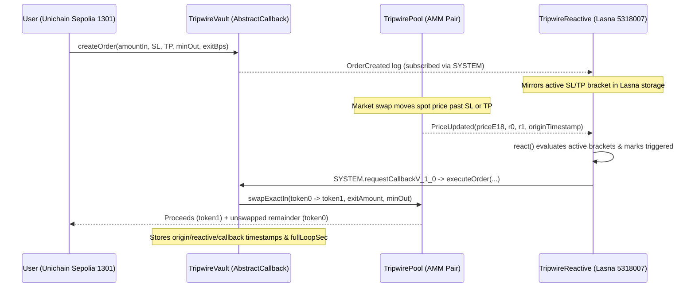

# Tripwire

**Sub-second Reactive Omni stop-loss and take-profit order automation for Unichain Sepolia.**

Built for the **Reactive Omni Buildathon — Every Second Counts** track using the official **Reactive Omni API** (`@reactive-lib-omni`: `SYSTEM = 0x8888888888888888888888888888888888888888`, `AbstractReactive`, `AbstractCallback`, `onlySystem`, `SYSTEM.requestCallbackV_1_0`).

---

## Why Omni (~1s) Matters Here

On volatile AMM pairs, a 7-second legacy reactive block time or a polling off-chain keeper means a stop-loss lands blocks after a cascade has already drained the pool. **Tripwire** keeps active stop-loss and take-profit brackets directly in Reactive Lasna state (`~1s` CometBFT finality, zero off-chain keepers) and emits a `requestCallbackV_1_0` unwind back to Unichain Sepolia the moment `TripwirePool` emits `PriceUpdated`.

## Architecture



## Contracts

| Contract | Chain | Role |
| --- | --- | --- |
| `src/TripwireReactive.sol` | Reactive Lasna (`5318007`) | Inherits `AbstractReactive`. Subscribes to `OrderCreated`, `OrderCancelled`, and `PriceUpdated` via `SYSTEM.subscribe`. Evaluates brackets in `react()` (`onlySystem`) and dispatches `SYSTEM.requestCallbackV_1_0`. |
| `src/TripwireVault.sol` | Unichain Sepolia (`1301`) | Inherits `AbstractCallback`. Holds deposited `token0`, supports full or partial exits (`exitBps` 1..10000), enforces `onlyServiceProvider` + `onlyCallbackSender(reactive_)` + on-chain spot-price re-check + `minOut` slippage guard, and records full-loop latency on-chain. |
| `src/TripwirePool.sol` | Unichain Sepolia (`1301`) | Self-contained Uniswap-v2-style constant-product AMM pair (0.30% fee) emitting `Sync` and timestamped `PriceUpdated`. |
| `src/MockERC20.sol` | Unichain Sepolia (`1301`) | Minimal testnet ERC-20 (`tWETH`, `tUSDC`) for deterministic liquidity. |

## Security Invariants

1. **Omni-only authentication:** `TripwireReactive.react` is guarded by `onlySystem` (`0x8888888888888888888888888888888888888888`). `TripwireVault.executeOrder` is guarded by both `onlyServiceProvider` (Unichain Sepolia callback proxy `0x775c9B990ADe401060B78D0e98684eEf8d2466C1`) and `onlyCallbackSender(reactive_)`.
2. **No double-fire:** `TripwireReactive` marks an order `triggered` and removes it from `_activeOrderIds` before requesting the callback; `TripwireVault` flips `order.status = Executed` before calling `pool.swapExactIn` (CEI + `nonReentrant`).
3. **Defense-in-depth price & slippage checks:** `TripwireVault.executeOrder` re-verifies `pool.spotPriceE18()` against the order's SL/TP threshold and enforces `minOut` on the swap.
4. **Testnet-only safety:** Deployment scripts enforce `block.chainid == 5318007` (Lasna) and `block.chainid == 1301` (Unichain Sepolia) and abort on any mainnet chain ID.

## Quickstart (Local Tests)

```bash
forge test -vvv
```

All 8 Foundry tests simulate the exact Reactive Omni system contract (`vm.etch` at `0x8888...8888`) and callback proxy payload injection:
- `test_StopLossFullLoopAndLatency`
- `test_TakeProfitPartialExitLoop`
- `test_InRangeNoOp`
- `test_CancelOrderPreventsCallback`
- `test_NoDoubleFireOnRepeatedPriceEventsOrReplay`
- `test_AuthGuardsRejectSpoofedCalls`
- `test_SlippageProtectionAndValidationGuards`
- `test_PauseAndUnsubscribeLifecycle`

## Testnet Deployment Order (Lasna + Unichain Sepolia)

Use throwaway testnet keys only. Fund Lasna (`lREACT`) via the official Sepolia/Base Sepolia faucet contracts (`0x9b9BB25f1A81078C544C829c5EB7822d747Cf434` / `0x2afaFD298b23b62760711756088F75B7409f5967`).

```bash
# 1. Deploy TripwireReactive on Reactive Lasna (5318007)
forge script script/DeployTripwire.s.sol:DeployReactiveLasna \
  --rpc-url lasna --broadcast --verify --verifier sourcify

# 2. Deploy Pool + Vault on Unichain Sepolia (1301)
REACTIVE_CONTRACT=<lasna_addr> \
forge script script/DeployTripwire.s.sol:DeployUnichainOriginDest \
  --rpc-url unichain_sepolia --broadcast

# 3. Subscribe TripwireReactive to Pool + Vault on Lasna (5318007)
REACTIVE_CONTRACT=<lasna_addr> POOL_CONTRACT=<pool_addr> VAULT_CONTRACT=<vault_addr> \
forge script script/DeployTripwire.s.sol:ConfigureReactiveLasna \
  --rpc-url lasna --broadcast
```

## Full-Loop Latency Measurement

After triggering a live testnet stop-loss or take-profit swap, generate the latency table directly from chain receipts:

```bash
./script/measure-loop.sh <origin_tx_hash> <lasna_reactive_tx_hash> <callback_tx_hash>
```

| Stage | Chain | Tx Hash | Block Timestamp | Delta |
| --- | --- | --- | --- | --- |
| Origin Swap (`PriceUpdated`) | Unichain Sepolia (`1301`) | _Pending live testnet deploy_ | — | 0s |
| Reactive Evaluation (`react`) | Reactive Lasna (`5318007`) | _Pending live testnet deploy_ | — | — |
| Destination Unwind (`executeOrder`) | Unichain Sepolia (`1301`) | _Pending live testnet deploy_ | — | — |

## License

MIT — see [LICENSE](./LICENSE). Third-party libraries: `forge-std` (MIT/Apache-2.0) and `Reactive-Network/reactive-lib-omni`.
